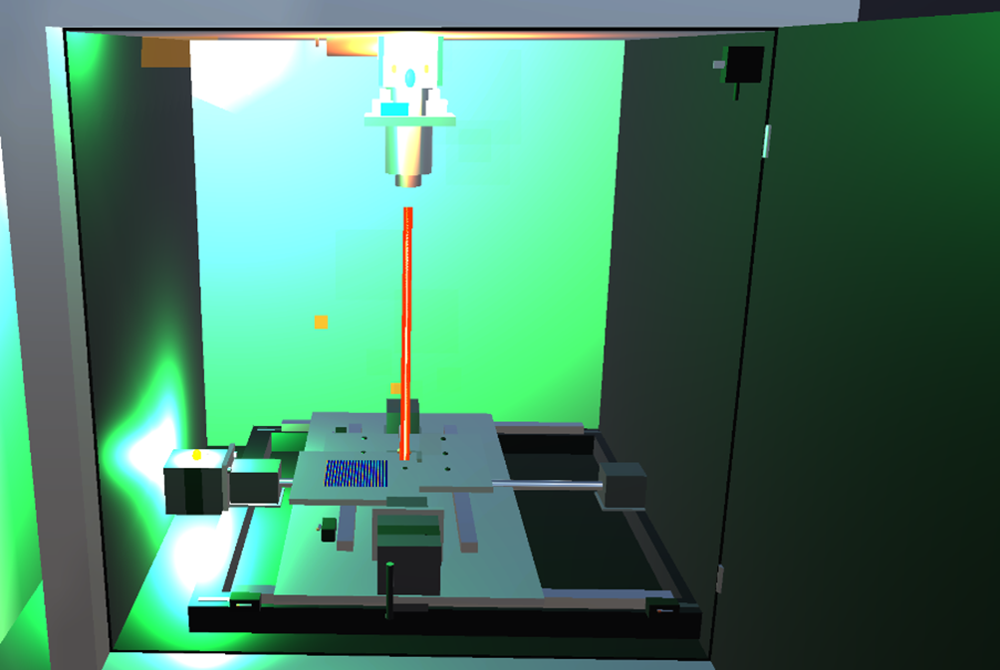
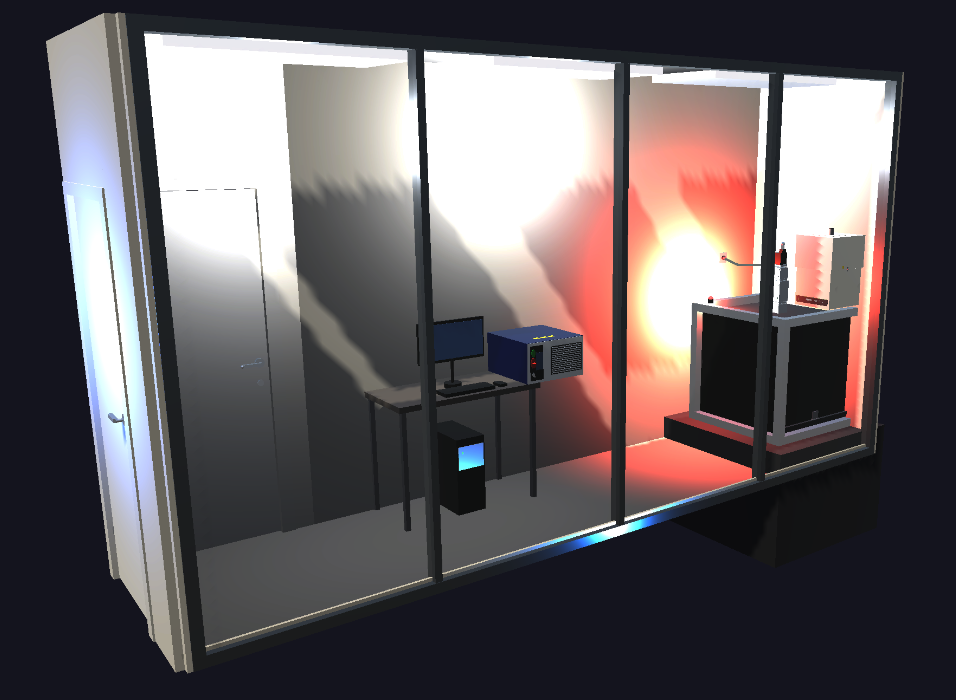
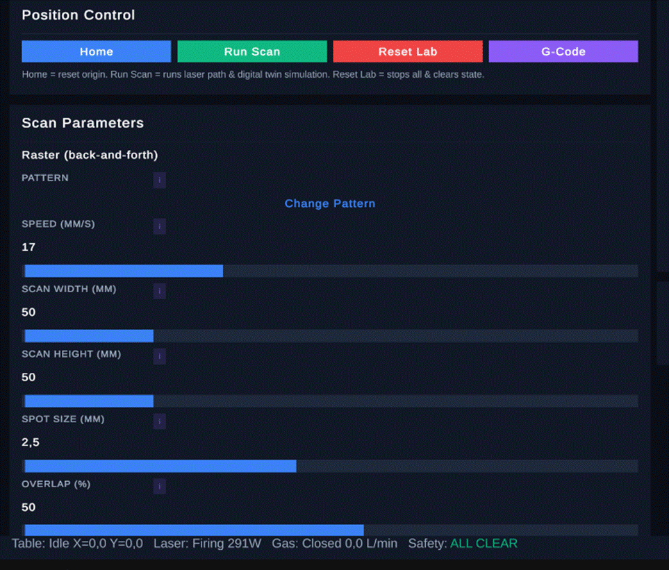
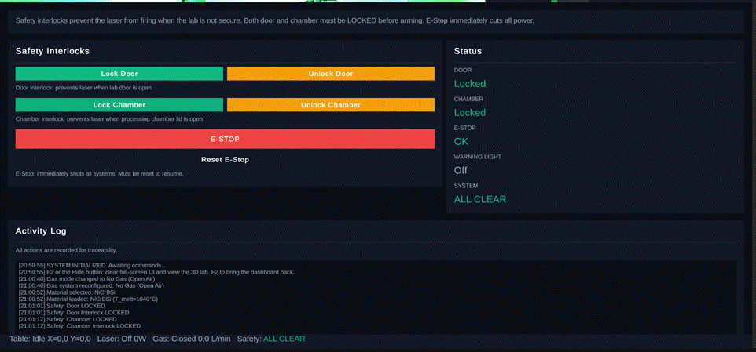
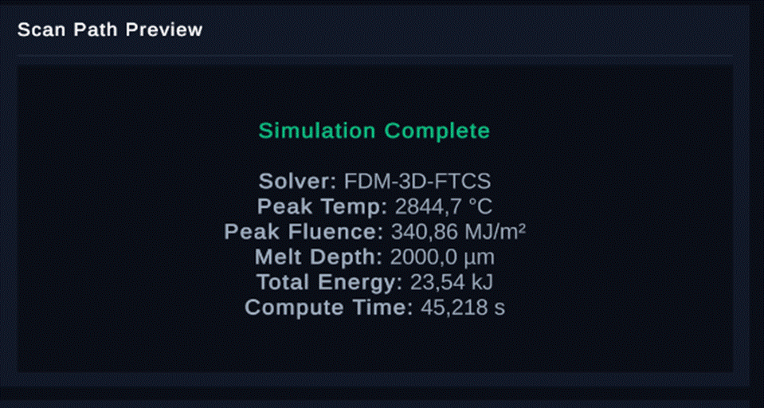
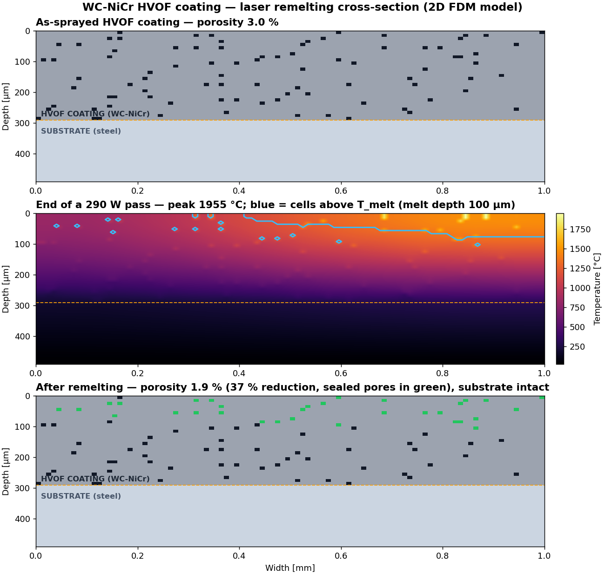
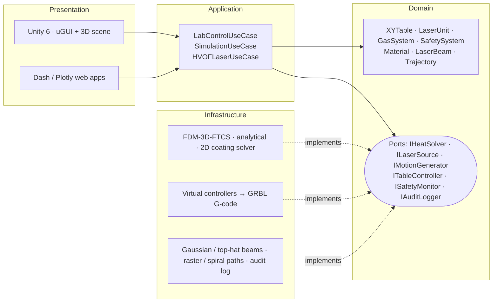
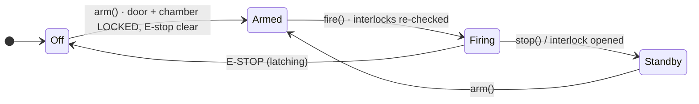

<div align="center">

# HVOF Laser Treatment Laboratory — Design & Digital Twin

**Design, 3D digital twin and thermal simulation of a Class 4 fibre-laser laboratory that remelts HVOF thermal-spray coatings — engineered for the CDAL research group at UPC (Universitat Politècnica de Catalunya).**


[](LICENSE)



[**Documentation**](docs/README.md) · [**Architecture**](docs/ARCHITECTURE.md) · [**Thermal model**](docs/THERMAL_MODEL.md) · [**Safety**](docs/SAFETY_SYSTEM.md) · [**Lab design & cost**](docs/LAB_DESIGN_AND_COST.md) · [**Quick start**](#quick-start)

</div>

---

## The problem

High-Velocity Oxy-Fuel (HVOF) spraying puts dense, wear- and corrosion-resistant coatings on turbine runners, landing gear and valves. As sprayed, those coatings still carry **micro-porosity, oxide inclusions and unmelted particles** — the places where corrosion and cracks start. In hydropower alone, a single cavitation repair on a turbine runner can cost **up to €100 000** and weeks of downtime.

**Laser surface remelting** fixes this: a scanned beam melts only the top of the coating, sealing pores and refining the microstructure without touching the substrate. The CDAL research group needed a laboratory to do it — inside a **5 m × 1.27 m corridor**, with a **Class 4 laser**, on a research budget.

## What we built

A complete, simulation-validated blueprint for that laboratory — before a single part was bought:

| | |
|---|---|
| 🔬 **Research** | 100-page study of HVOF coatings, post-treatments and laser technologies → selection of a **300 W Yb-fibre laser** (IPG YLR-300-AC, 1070 nm). |
| 🏗️ **Lab design** | Class 4-compliant layout for a 17.5 m³ room: interlocked enclosure, laser curtains, argon atmosphere with O₂ monitoring, fume extraction — mapped to **14 IEC, ISO, EN, ANSI and Spanish standards**. |
| ⚙️ **X-Y table** | Custom GRBL motion stage — 300 × 250 mm travel, **1 µm** theoretical resolution — from catalogue parts for **€115** of electronics. |
| 🎮 **3D digital twin** | **Unity 6** walk-through of the real room with a full operator dashboard, live interlocks, beam VFX and a background-thread 3D heat solver. |
| 🔥 **Thermal engine** | **Python** finite-difference solvers (3D FTCS + pore-aware 2D coating model) — results fall inside **5/5 published benchmarks**. |
| 🛡️ **Safety logic** | State machines that make "fire with the door open" *unrepresentable*, a latching E-stop and a full audit trail — covered by tests. |
| 💶 **Costing** | Itemised bill of materials with supplier quotes: **€73 824 ± 15 %**. |

## At a glance

<div align="center">

| 🧾 **€73.8k** | 🧪 **5 / 5** | ✅ **167** | 🧱 **24k+** | 🖥️ **2** |
|:---:|:---:|:---:|:---:|:---:|
| capital estimate, ±15 % | literature benchmarks met | automated tests (pytest + NUnit) | lines of Python & C# | runtimes, one domain model |

</div>

## See it

| The laboratory (Unity) | Operator dashboard |
|---|---|
|  |  |
| **Safety interlocks — ALL CLEAR** | **Scan finished — thermal result** |
|  |  |

➡️ A complete treatment cycle, screen by screen: [**Operator Walkthrough**](docs/OPERATOR_WALKTHROUGH.md)

## Physics that holds up

The coating model generates a porous WC-NiCr microstructure, scans a Gaussian beam across it and tracks every cell that melts. At **290 W** the melt front reaches **100 µm** into a 300 µm coating, porosity drops by **37 %**, and the steel substrate never melts:



| Metric (WC-NiCr, 290 W) | Simulated | Published range | |
|---|---:|---:|:-:|
| Porosity reduction | 36.8 % | 30 – 72 % | ✅ |
| Melt depth | 100 µm | 50 – 150 µm | ✅ |
| Peak surface temperature | 1 955 °C | 1 400 – 2 000 °C | ✅ |
| Heat-affected zone | 180 µm | 100 – 200 µm | ✅ |
| Substrate melting | none | none | ✅ |

Reproduce with `python run_hvof_validation.py` (≈ 40 s). Equations, numerics and limitations: [**Thermal Model**](docs/THERMAL_MODEL.md).

## Architecture

Two runtimes — Python for numerics and web dashboards, Unity for the 3D twin — implement **the same Clean Architecture and domain model**. In Unity each layer is a separate assembly and the domain compiles with `noEngineReferences`, so the layering is enforced by the compiler, not by convention.



Swapping the `Virtual*` adapters for serial drivers is all it takes to steer the real Arduino-based table. Details, sequence diagram and design decisions: [**Architecture**](docs/ARCHITECTURE.md).

## Safety by construction



- **Travel-limit validation** — a scan that would leave the envelope is rejected *before* the first step pulse.
- **Mandatory homing** — no motion until both axes are referenced; `ERROR` is only left by re-homing.
- **Interlock-gated laser** — checked at arm *and* at fire; opening a door mid-shot aborts emission and logs `AUTO_STOP_LASER`.
- **Latching E-stop** — laser off, gas closed, table frozen, until an explicit reset.

Plus a STRIDE threat model and the hardware/standards map: [**Safety System**](docs/SAFETY_SYSTEM.md).

## Quick start

**Python** — thermal engine, lab-control twin, dashboards

```bash
cd python
pip install -r requirements-dev.txt
python -m pytest                          # 74 tests
python lab_control/run_dashboard.py       # lab-control twin  → http://127.0.0.1:8051
python run_gui.py                         # simulation lab    → http://localhost:8050
python landing.py                         # landing page      → http://localhost:8049
```

**Unity** — 3D digital twin

1. Open `UnityHVOF/` in **Unity 6000.3.11f1** (Unity Hub → *Add project from disk*).
2. Open `Assets/important.unity` → **Play**. Press **F2** to hide the dashboard and explore the room.

More: [`python/README.md`](python/README.md) · [`UnityHVOF/README.md`](UnityHVOF/README.md)

## Repository structure

```text
.
├── python/                 # Thermal engine, lab-control digital twin, Dash apps, 74 tests
│   ├── domain/ application/ infrastructure/ presentation/
│   ├── lab_control/        # Table · laser · gas · safety bounded context + dashboard
│   ├── tests/  tools/
│   └── run_hvof_validation.py
├── UnityHVOF/              # Unity 6 (URP) project — 3D twin, C# port, 93 tests
│   └── Assets/Scripts/{Domain,Application,Infrastructure,Presentation,Tests}
├── docs/
│   ├── ARCHITECTURE.md  THERMAL_MODEL.md  SAFETY_SYSTEM.md
│   ├── LAB_DESIGN_AND_COST.md  OPERATOR_WALKTHROUGH.md
│   ├── research/           # Midterm technical study (literature review)
│   └── media/images/
├── .github/workflows/      # CI: pytest on Python 3.10 & 3.12
└── LICENSE
```

## Research summary

The engineering documents condense the underlying study into reusable data:

| Topic | Where |
|---|---|
| HVOF process, typical coatings and their defects | [Midterm technical study](docs/research/midterm-technical-study.md) |
| Post-treatment comparison and laser technology selection | [Lab Design & Cost → Laser selection](docs/LAB_DESIGN_AND_COST.md#laser-selection) |
| Room constraints, X-Y table requirements, parts and accuracy | [Lab Design & Cost](docs/LAB_DESIGN_AND_COST.md) |
| Thermal model, numerics and validation | [Thermal Model](docs/THERMAL_MODEL.md) |
| Class 4 safety measures and applicable standards | [Safety System](docs/SAFETY_SYSTEM.md) |
| Itemised bill of materials (€73 824 ± 15 %) | [Lab Design & Cost → Cost estimate](docs/LAB_DESIGN_AND_COST.md#cost-estimate-15-) |

## Tech stack

| Area | Tools |
|---|---|
| Simulation & numerics | Python 3, NumPy, explicit finite differences (FTCS), Gaussian beam optics |
| Web dashboards | Dash, Plotly (3D lab scene), dash-bootstrap-components, Matplotlib |
| 3D digital twin | Unity 6, C#, Universal Render Pipeline, uGUI / TextMesh Pro, Input System, custom heat-map shader |
| Motion control | GRBL G-code (`G90 G21 G28 G1 M3 M5`), Arduino UNO + CNC Shield, NEMA 17 / TB6600 |
| Quality | pytest, Unity Test Framework (NUnit), GitHub Actions, Clean Architecture, SOLID, STRIDE |
| Engineering | Class 4 laser safety (IEC 60825-1/-4, ISO 11553, EN 207 …), bill-of-materials costing |

## Limitations & next steps

Honest scope: the design is **fully simulated, not yet built**. Laser parameters have not been tested on physical NiCr / carbide samples; the thermal models use constant properties and ignore melt-pool and shielding-gas convection; the Z axis is manual, so only flat samples are supported.

Natural next steps: replace the `Virtual*` controllers with serial drivers for the Arduino/GRBL table · calibrate the solver against the first physical samples · temperature-dependent properties and latent heat · a motorised Z axis for curved parts.

## License

Code is released under the [MIT License](LICENSE).
