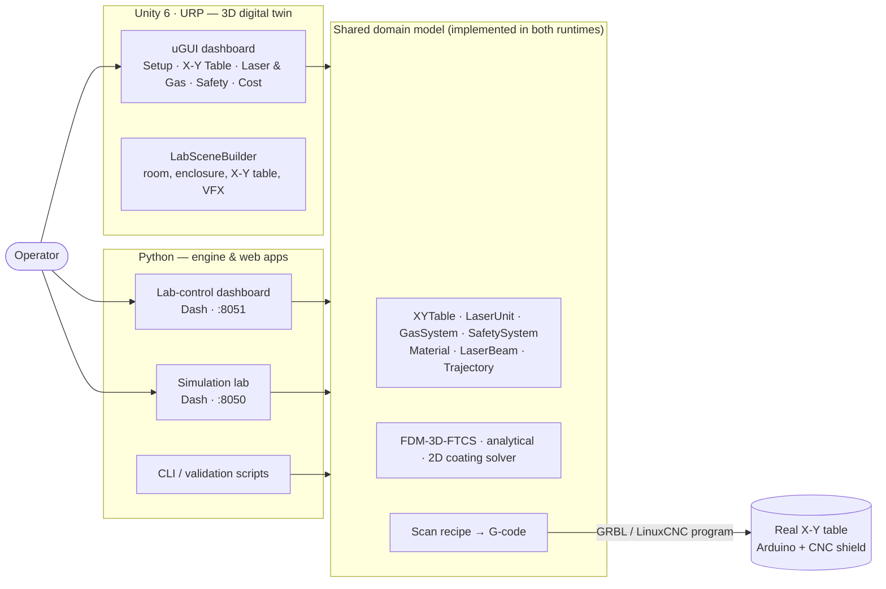
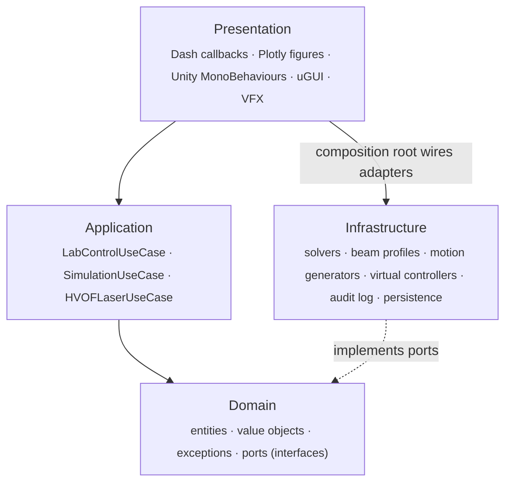
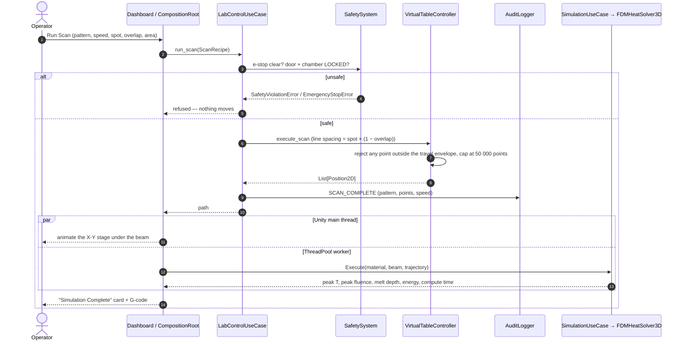

# Architecture

The laboratory exists twice in software: a **Python** implementation (thermal engine, lab-control digital twin, web dashboards) and a **Unity / C#** port that renders the room in 3D. Both follow the same Clean Architecture, share one domain model, and enforce the same safety state machine. A behaviour change on one side can be cross-checked against the other.

- [System context](#system-context)
- [Layers](#layers)
- [Ports and adapters](#ports-and-adapters)
- [A scan, end to end](#a-scan-end-to-end)
- [Python ↔ Unity parity](#python--unity-parity)
- [Design decisions](#design-decisions)

---

## System context

## Layers

Dependencies point inward only. Nothing in the domain knows about Dash, Plotly, Unity, files or time.

| Layer | Python | Unity / C# | Rule |
|---|---|---|---|
| **Domain** | [`python/domain/`](../python/domain), [`python/lab_control/domain/`](../python/lab_control/domain) | [`Scripts/Domain/`](../UnityHVOF/Assets/Scripts/Domain) | Pure language, zero framework imports. Entities validate every state change. |
| **Application** | [`python/application/`](../python/application), [`python/lab_control/application/`](../python/lab_control/application) | [`Scripts/Application/`](../UnityHVOF/Assets/Scripts/Application) | Orchestrates entities through ports; the single place where state changes and audit entries are written. |
| **Infrastructure** | [`python/infrastructure/`](../python/infrastructure), [`python/lab_control/infrastructure/`](../python/lab_control/infrastructure) | [`Scripts/Infrastructure/`](../UnityHVOF/Assets/Scripts/Infrastructure) | Concrete adapters: numerics, virtual hardware, logging, JSON repositories. |
| **Presentation** | [`python/presentation/`](../python/presentation), [`python/lab_control/presentation/`](../python/lab_control/presentation) | [`Scripts/Presentation/`](../UnityHVOF/Assets/Scripts/Presentation) | Renders entity state; never holds business rules. |
| **Composition root** | [`lab_control/composition_root.py`](../python/lab_control/composition_root.py) | [`Presentation/CompositionRoot.cs`](../UnityHVOF/Assets/Scripts/Presentation/CompositionRoot.cs) | The only place that knows concrete types. |

**Enforced, not just documented.** In Unity every layer is its own assembly. `HVOFSim.Domain` and `HVOFSim.Application` compile with `noEngineReferences: true`, so the compiler rejects any `using UnityEngine` in them — the domain is plain C# that could run on a server or a microcontroller host unchanged.

| Assembly | References | UnityEngine allowed? |
|---|---|---|
| `HVOFSim.Domain` | — | ❌ |
| `HVOFSim.Application` | Domain | ❌ |
| `HVOFSim.Infrastructure` | Domain | ✅ (only the JSON material repository uses it) |
| `HVOFSim.Presentation` | Domain, Application, Infrastructure, TMP, URP, Input System | ✅ |
| `HVOFSim.Tests` (EditMode) | Domain, Application, Infrastructure | ❌ |
| `HVOFSim.Tests.PlayMode` | all + Test Runner | ✅ |

## Ports and adapters

Every external capability is an interface owned by the domain; implementations are swappable (Strategy pattern) without touching use cases.

| Port | Responsibility | Adapters |
|---|---|---|
| `IHeatSolver` | Solve transient heat conduction for a material, beam and trajectory | `FDMHeatSolver3D` (explicit FTCS), `AnalyticalHeatSolver` |
| `ILaserSource` | Surface intensity distribution of the beam | `GaussianLaserSource`, `TopHatLaserSource` (+ `LaserFactory` for fibre / Nd:YAG / CO₂ presets) |
| `IMotionGenerator` | Produce a time-stamped `Trajectory` | `RasterGenerator` (serpentine), `SpiralGenerator` (Archimedean), `LinearGenerator` |
| `ICoatingGenerator` / `ICoatingSolver` (C#) | Synthesise an HVOF microstructure and remelt it | `HVOFCoatingGenerator`, `FDMCoatingSolver2D` (concrete classes on the Python side) |
| `ITableController` | Home, move, scan, emit G-code | `VirtualTableController` |
| `ILaserController` · `IGasController` · `ISafetyMonitor` | Drive laser, argon and interlocks | `Virtual*Controller`, `VirtualSafetyMonitor` |
| `ICostCalculator` | Equipment catalogue and budget | `EquipmentCostCatalog` |
| `IAuditLogger` | Traceability of every action and safety event | `InMemoryAuditLogger` (lab), `AuditLogger` (simulation runs, SHA-256 result hash, secret redaction) |
| `IMaterialRepository` | Material property lookup | `JsonMaterialRepository`, optional Materials Project adapter |

Replacing the `Virtual*` adapters with serial-port drivers is the only change needed to steer physical hardware.

## A scan, end to end

In Unity the solve runs on a `ThreadPool` worker so the 3D scene keeps animating; the result is marshalled back to the main thread in `Update()`. The Python lab-control dashboard stops at the path and G-code; full thermal runs live in the separate simulation-lab app.

The G-code path is the same recipe rendered as text: `G90` (absolute), `G21` (mm), `G28` (home), `F<feed>`, `M3` laser on, `G1 X… Y…` moves, `M5` laser off, `G28` — directly loadable by GRBL or LinuxCNC.

## Python ↔ Unity parity

| Concern | Python | Unity / C# |
|---|---|---|
| Domain entities | `XYTable`, `LaserUnit`, `GasSystem`, `SafetySystem` (dataclasses) | `LabEntities.cs` (sealed classes) |
| Simulation entities | `Material`, `LaserBeam`, `Trajectory`, `SimulationResult` | `Entities.cs` |
| Value objects | frozen dataclasses (`Position2D`, `ScanRecipe`, `GCodeLine` …) | `ValueObjects.cs` + `LaserTypeConfig`, `GasConfig`, `ChamberConfig`, `MaterialPresets` |
| Thermal solvers | NumPy, vectorised slicing | `FDMHeatSolver3D.cs`, `AnalyticalSolver.cs`, `FDMCoatingSolver2D.cs` |
| Use cases | `LabControlUseCase`, `SimulationUseCase`, `HVOFLaserUseCase` | `UseCases.cs` |
| Tests | 74 pytest cases | 93 NUnit cases (EditMode + PlayMode) |
| UI | Dash + Plotly 3D lab | uGUI dashboard + procedurally built 3D room, `F2` toggles the overlay |

Unity extends the Python model with configurable laser types (Yb-fibre, CO₂, Nd:YAG, diode), shielding gases (Ar, N₂, He, Ar-H₂), chamber types (aluminium, steel, open-air, vacuum, custom) and a heat-map shader for the result field.

## Design decisions

| Decision | Why |
|---|---|
| **Clean Architecture + DI** | The lab did not exist yet. Keeping hardware behind ports let the team validate control logic, safety rules and G-code *before* purchasing anything, and leaves a direct path to real drivers. |
| **Two runtimes, one model** | Python is the fastest place to iterate on numerics and is testable in CI; Unity gives reviewers and future operators a walkable, physically-scaled room. Mirroring the model keeps them honest against each other. |
| **Finite-state machines on every device** | Illegal transitions (fire before arm, move before home, scan with an open door) are unrepresentable rather than merely discouraged — see [Safety System](SAFETY_SYSTEM.md). |
| **Explicit FTCS with automatic CFL step** | Simple, transparent and easy to verify; the solver derives Δt from the stability limit with a 20 % margin instead of trusting user input — see [Thermal Model](THERMAL_MODEL.md). |
| **Grid-size cap (5 M cells) & 50 000-point scan cap** | Availability: a mistyped recipe cannot exhaust memory or flood the motion controller. |
| **Procedural scene (`LabSceneBuilder`)** | All geometry is built from real dimensions in `LabRoomSpec`, so the same code can lay out a different room without remodelling. |
| **Frozen value objects** | Positions, recipes and G-code lines cannot be mutated after validation. |
