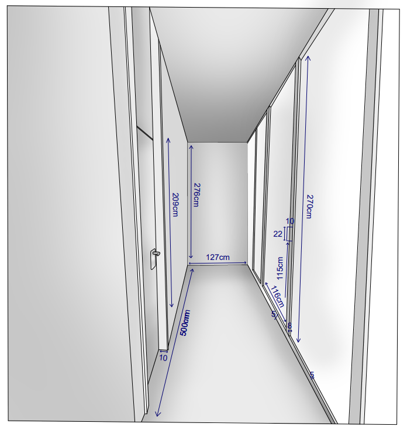
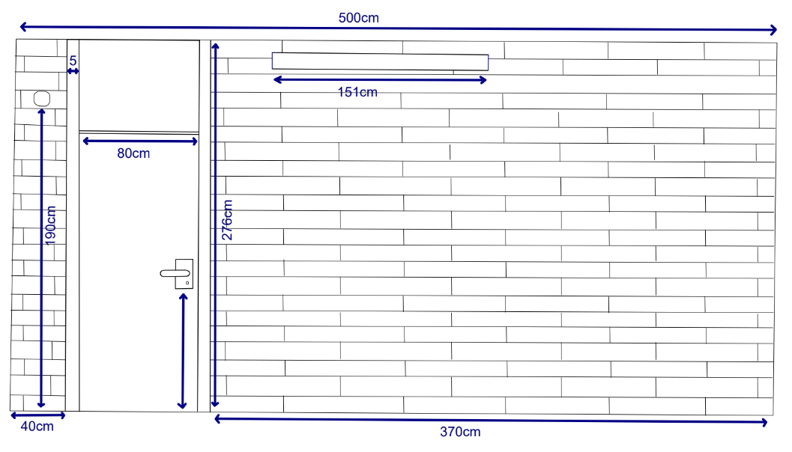
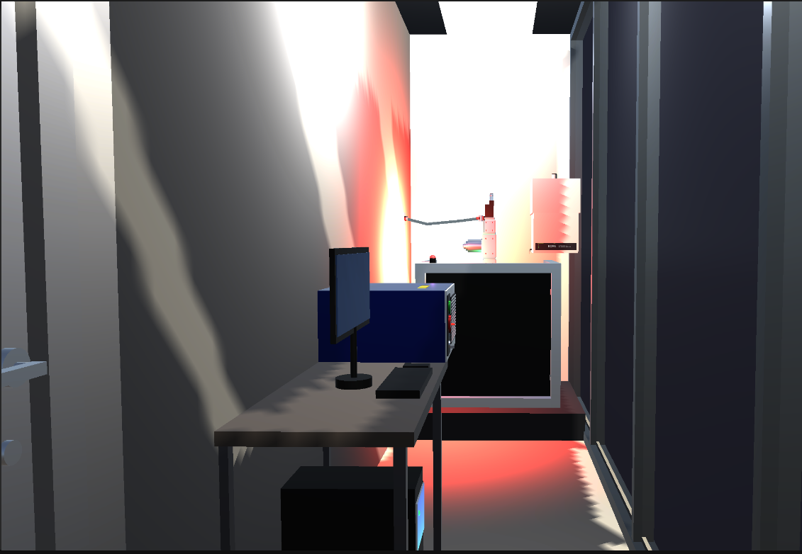
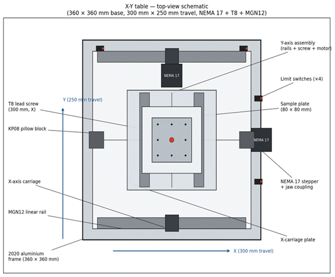
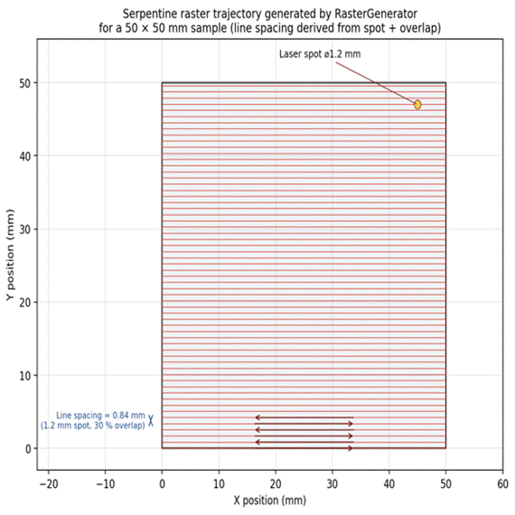
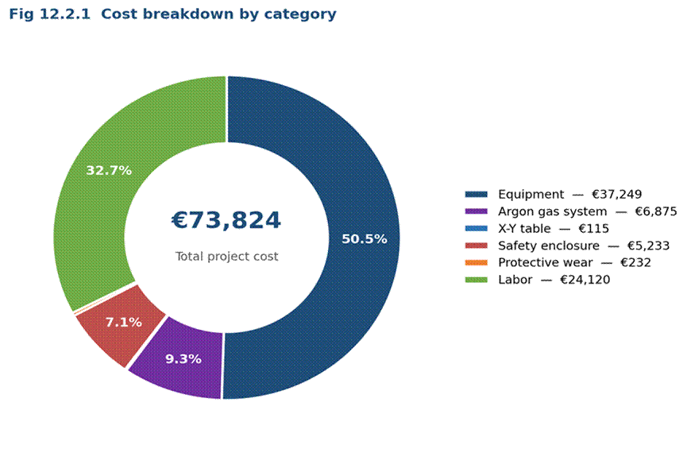
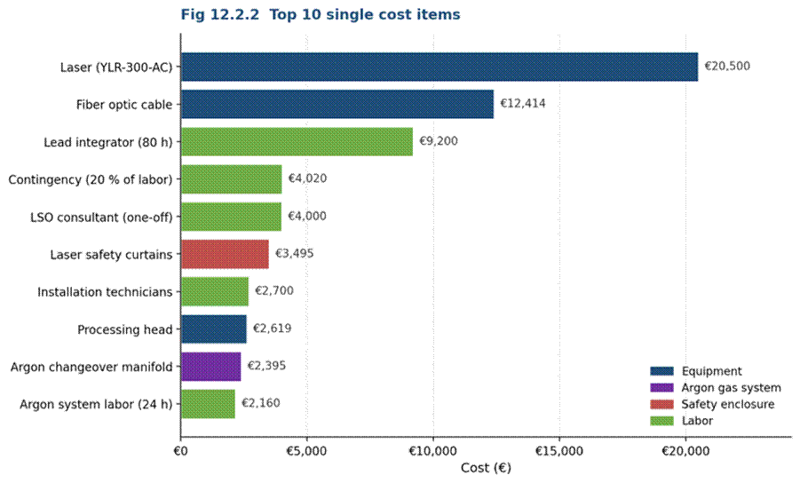

# Laboratory Design & Cost

Engineering summary of the physical laboratory designed for the **CDAL** research group (Light Alloys and Surface Treatments Design Centre, UPC).

- [Requirements](#requirements)
- [Laser selection](#laser-selection)
- [The room](#the-room)
- [Programmable X-Y table](#programmable-x-y-table)
- [Cost estimate (±15 %)](#cost-estimate-15-)

---

## Requirements

| Requirement | Target |
|---|---|
| Samples | Flat HVOF-coated coupons, 50 × 50 mm or 50 × 70 mm |
| Coatings | 100–500 µm thick (WC-CoCr, WC-NiCr, Cr₃C₂-NiCr, NiCrBSi, Stellite 6 …) |
| Process | Localised laser remelting to close porosity and dissolve oxides **without melting the substrate** |
| Reference recipe | 400–600 W fibre laser, 3.3–10 mm/s, 1.2 mm spot, 30 % overlap (WC-CoCr literature case) |
| Safety | Class 4 compliant room, interlocked enclosure, controlled argon atmosphere |
| Budget | Capital estimate with ±15 % accuracy |

## Laser selection

| Technology | λ | Verdict |
|---|---|---|
| **Yb fibre** | 1030–1070 nm | ✅ **Selected** — high wall-plug efficiency (25–30 %), single-mode beam quality, fibre delivery, compact and low-maintenance |
| Nd:YAG | 1064 nm | Lower efficiency, lamp/diode maintenance |
| High-power diode | 808–980 nm | Compact, but poor beam quality and ≈ 10 000 h lifetime |
| Nd:YVO₄ | 1064 nm | Limited to ≈ 50–100 W — not enough to remelt 100–500 µm coatings |
| CO₂ | 10.6 µm | Good absorption on carbides, but €150k–300k and needs mirror optics |

**Chosen source:** IPG Photonics **YLR-300-AC** — 300 W continuous-wave, 1070 nm, single-mode, paired with an AU3Tech A230E processing head.

## The room

Corridor-shaped room in the VG building, UPC Vilanova i la Geltrú: **5.00 × 1.27 × 2.76 m** (6.35 m², 17.5 m³). The narrow width drives most risks — restricted movement, escape routes, proximity to the beam — so equipment is laid out in one line: operator workstation → laser source → interlocked processing enclosure with the X-Y table.

| Room sketch | Wall elevation |
|---|---|
|  |  |

The same dimensions drive the procedural Unity scene ([`LabRoomSpec.cs`](../UnityHVOF/Assets/Scripts/Presentation/Scene/LabRoomSpec.cs)), which was used to check that the table and enclosure physically fit the corridor after scaling and rotation.

| Full laboratory | Operator eye level |
|---|---|
|  |  |

## Programmable X-Y table

A stacked X-over-Y stage carries the sample under a **stationary** laser head (simpler optical alignment than a gantry for 50 mm samples).

| Parameter | Value | Rationale |
|---|---|---|
| Travel | 300 mm (X) × 250 mm (Y) | ≥ 5 × sample size: room for acceleration ramps and side-parking for loading |
| Theoretical resolution | 1 µm | T8 lead screw (8 mm pitch) + 200-step NEMA 17 at 1/16 microstepping |
| Practical repeatability | ±20–50 µm | Backlash, carriage flex, microstep non-linearity — still ≪ 0.84 mm line spacing |
| Max speed | 250 mm/s | 25 × the fastest process speed, for quick non-process moves |
| Z (focus) | Manual, set at commissioning | Two motorised axes are sufficient for flat samples |
| Controller | Arduino UNO + CNC Shield v3 running GRBL | Standard G-code, also compatible with LinuxCNC |

**Mechanical parts list**

| Qty | Component | Specification | Function |
|---:|---|---|---|
| 4 | 2020 aluminium extrusion | 360 mm | Base frame |
| 4 | MGN12 linear rail | 300 mm (X) / 250 mm (Y) | Linear guidance |
| 4 | MGN12H carriage block | Pre-loaded, hardened steel | Carriage support |
| 1 | T8 lead screw, X | Ø 8 mm, 8 mm pitch, 300 mm | X drive |
| 1 | T8 lead screw, Y | Ø 8 mm, 8 mm pitch, 220 mm | Y drive |
| 2 | T8 brass lead nut | Anti-backlash | Screw-to-carriage |
| 4 | KP08 pillow block | 8 mm bore | Screw end support |
| 2 | NEMA 17 stepper | 1.8°/step, 0.4 N·m, bipolar | Actuation |
| 2 | Jaw coupling | 5 × 8 mm, flexible | Motor-to-screw |

**Motion control.** A scan recipe (pattern, power, speed, spot, overlap, area) is turned into a path with line spacing *s = spot × (1 − overlap)* — 0.84 mm for the 1.2 mm / 30 % reference. Three generators are available: bidirectional raster (default — uniform fluence, no idle return passes), Archimedean spiral and single line. A 50 × 50 mm sample at 10 mm/s takes ≈ 5 min, consistent with the 4.5 min reported in the reference study.

## Cost estimate (±15 %)

Bottom-up from a bill of materials with one supplier quotation per line (EUR, VAT-inclusive EU prices; labour at Catalan industry rates; 20 % contingency on labour).

| Category | Lines | Cost (EUR) | Share |
|---|---:|---:|---:|
| Equipment (laser, fibre, head, fume extractor) | 4 | 37 249.00 | 50.5 % |
| Labour (integration, electrician, LSO, installers, contingency) | 6 | 24 120.00 | 32.7 % |
| Argon gas system | 7 | 6 875.33 | 9.3 % |
| Safety enclosure & interlocks | 12 | 5 232.70 | 7.1 % |
| Protective wear | 3 | 231.81 | 0.3 % |
| X-Y table electronics & motors | 7 | 115.02 | 0.2 % |
| **Total** | | **73 823.86** | |

| Breakdown | Ten most expensive lines |
|---|---|
|  |  |

<b>Detailed bill of materials</b>

**Laser equipment chain**

| Component | Qty | EUR |
|---|---:|---:|
| IPG Photonics YLR-300-AC fibre laser source | 1 | 20 500.00 |
| Fibre-optic delivery cable | 1 | 12 414.00 |
| AU3Tech A230E processing head + SC2000 controller | 1 | 2 619.00 |
| AD Access laser fume extractor | 1 | 1 716.00 |

**Argon gas system**

| Component | Qty | EUR |
|---|---:|---:|
| Harris KH2004 automatic changeover manifold | 1 | 2 395.00 |
| Linde Redline C-200 dual-stage regulator (230 bar) | 5 | 1 935.00 |
| Aalborg acrylic flow meter for argon | 4 | 240.00 |
| Stainless tubing & fittings (2 m) | 1 | 133.33 |
| Cylinder safety valve (argon / oxygen) | 5 | 195.00 |
| Spectrocem 3-way purge block (DIN 6) | 1 | 837.00 |
| Trolex TX6373 oxygen-depletion monitor | 1 | 1 140.00 |

**X-Y table electronics**

| Component | Qty | EUR |
|---|---:|---:|
| TopDirect TB6600 stepper driver | 2 | 28.00 |
| Arduino UNO Rev3 | 1 | 29.30 |
| CNC Shield v3 | 1 | 2.95 |
| USB A-B cable, 2 m | 1 | 5.14 |
| 12 V / 5 A power supply | 1 | 13.42 |
| Shielded bus cable 2 × 2 × 0.8 mm, 25 m | 1 | 19.59 |
| NEMA 17 bipolar stepper, 0.45 N·m | 2 | 16.62 |

**Safety enclosure & interlocks**

| Component | Qty | EUR |
|---|---:|---:|
| 3030 aluminium extrusion, 400 mm | 12 | 132.96 |
| M5 bolts + T-slot nuts | 1 | 9.79 |
| Laser warning LED | 1 | 2.51 |
| Door handle | 1 | 1.80 |
| Hinges | 2 | 6.40 |
| Door microswitch interlock | 2 | 16.24 |
| Galvanised steel sheet 2 mm, 40 × 40 cm | 6 | 120.00 |
| Hoyles IG432 door-interlock controller | 1 | 1 210.00 |
| Illuminated "Laser On" sign | 1 | 26.00 |
| Magnetic reed door switch | 1 | 32.00 |
| Panasonic SF4D-H16 laser safety curtain | 3 | 3 495.00 |
| CO₂ fire extinguisher, 5 kg | 2 | 180.00 |

**Protective wear**

| Component | Qty | EUR |
|---|---:|---:|
| Amber safety eyewear, OD ≥ 5 @ 1070 nm | 3 | 30.00 |
| EN 388 nylon gloves, PU coating | 3 | 69.33 |
| 3M Peltor Optime I (SNR 27 dB) | 3 | 132.48 |

**Labour**

| Component | EUR |
|---|---:|
| Lead integrator (80 h @ 115 €/h) | 9 200.00 |
| Electrician (24 h @ 85 €/h) | 2 040.00 |
| Laser Safety Officer (one-off) | 4 000.00 |
| Installation technicians (60 h @ 45 €/h) | 2 700.00 |
| Argon system installer (24 h @ 90 €/h) | 2 160.00 |
| Contingency (20 % of labour) | 4 020.00 |

**Observations from the cost breakdown**

- **Supplier concentration** — ≈ 45 % of the budget sits with two suppliers (laser source and fibre cable): negotiation there moves the bottom line most.
- **Labour sensitivity** — sourcing the lead integrator from within the faculty could cut that line by an estimated 30–50 %.
- **Safety curtains** are 67 % of the safety subtotal; a closed metallic enclosure in front of the window could replace them for about a third of the cost.
- **Argon manifold** — for a few hours of use per week, a single manual regulator could save ≈ €1 500–2 000.
- **The X-Y table is the cheapest block** (€115 of electronics) because it uses catalogue parts and open GRBL firmware instead of commercial motion stages.
