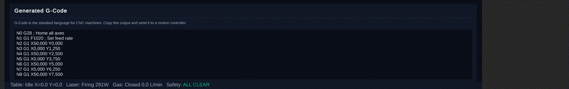

# Operator Walkthrough

One complete treatment cycle in the Unity digital twin, in the order the software enforces it:

**3D scene → table set-up → safety interlocks → laser sequence → scan & thermal result → G-code → emergency stop**

Every screen renders only what the four domain entities (`XYTable`, `LaserUnit`, `GasSystem`, `SafetySystem`) currently hold, and every action goes through `LabControlUseCase` — the single place where state changes and audit entries are written.

---

### 1 · The lab

On start-up the procedurally built room appears. **F2** hides the dashboard to inspect the scene; right-drag / arrow keys orbit, **WASD** fly, **Shift** speeds up. Inside the green-lit processing chamber: the laser head, the X-Y table with its 80 × 80 mm sample plate (M4 hole pattern) and the Class 4 enclosure. The orange beam is only drawn while the laser is firing.

### 2 · X-Y Table tab — build the recipe

| Control | What it does in code |
|---|---|
| **Home** | Sends `G28`; `XYTable` goes `Idle → Homing → Idle` |
| **Run Scan** | Builds a `ScanRecipe` from the sliders → `LabControlUseCase.run_scan()` → path that drives the carriage and the thermal solver |
| **Reset Lab** | Stops every subsystem and clears results |
| **G-Code** | `LabControlUseCase.generate_gcode()` → GRBL program in the *Generated G-Code* card |

Sliders: speed (slower ⇒ more energy per point), scan width / height (clipped to chamber travel), spot size (also sets peak intensity $I_0 = 2P/\pi w_0^2$) and overlap (line spacing $s = \text{spot}\,(1-\text{overlap})$ — 1.25 mm for a 2.5 mm spot at 50 %).

### 3 · Safety tab — make the lab safe

With only the door locked the system reports **NOT READY**; locking the chamber as well flips it to **ALL CLEAR** and enables **Arm**. The Activity Log timestamps every action.

| Door locked, chamber open | Both locked |
|---|---|
|  |  |

### 4 · Laser & Gas tab — Set Power → Arm → Fire

Ytterbium fibre, 1070 nm. Fire asks for confirmation ("FIRE LASER?"); the 3D beam, glow and spark VFX switch on and the status bar shows `Laser: Firing 295W`.

| Standby | Armed | Firing |
|---|---|---|
|  |  |  |

### 5 · Scan result

When the scan finishes, the 3D solver that ran on a worker thread reports back:

| Field | Meaning |
|---|---|
| Solver | `FDM-3D-FTCS` — explicit finite-difference, 3D |
| Peak temp | Hottest cell — well above the 1 040 °C NiCrBSi melting point, so the coating is fully molten in the affected zone |
| Peak fluence | Time-integral of absorbed Gaussian intensity at the hottest point |
| Melt depth | Depth of the melt pool (2 mm is the depth of the modelled domain, i.e. saturation) |
| Total energy | Absorbed optical energy over the full raster |
| Compute time | Wall-clock time of the solve |

### 6 · G-code

`G28` homes, `G1 F1020` sets the feed (17 mm/s × 60), then rows alternate between X = 50 and X = 0 while Y steps by the computed line spacing — a program ready for any GRBL / LinuxCNC controller.

### 7 · Emergency stop

One button: `trigger_e_stop()` latches the E-stop, turns the laser off, closes the gas and freezes the table in `ERROR`. Nothing protected runs again until **Reset E-Stop** is pressed *and* both interlocks are still locked.

---

| # | Screen | System state |
|---|---|---|
| 1 | 3D lab | Application started; F2 hides the dashboard |
| 2 | X-Y Table | Recipe 50 × 50 mm, 17 mm/s, 2.5 mm spot, 50 % overlap |
| 3 | Safety — partial | Door LOCKED, chamber OPEN → NOT READY |
| 4 | Safety — clear | Both LOCKED → ALL CLEAR, Arm enabled |
| 5–7 | Laser | 295 W: Standby → Armed → Firing |
| 8 | Result | FDM-3D-FTCS: peak 2 844.7 °C, melt depth 2 mm, 23.54 kJ |
| 9 | G-code | GRBL program generated |
| 10 | E-stop | `EStopPressed` overrides every interlock → NOT READY |
