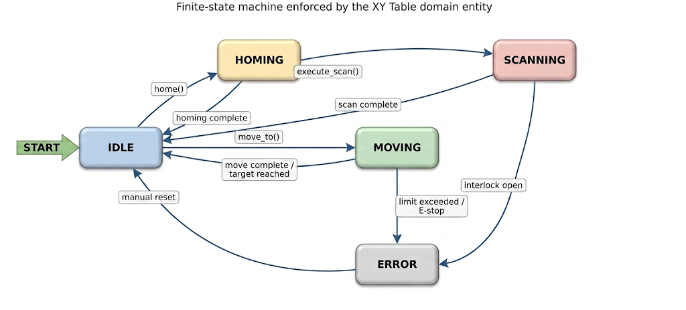
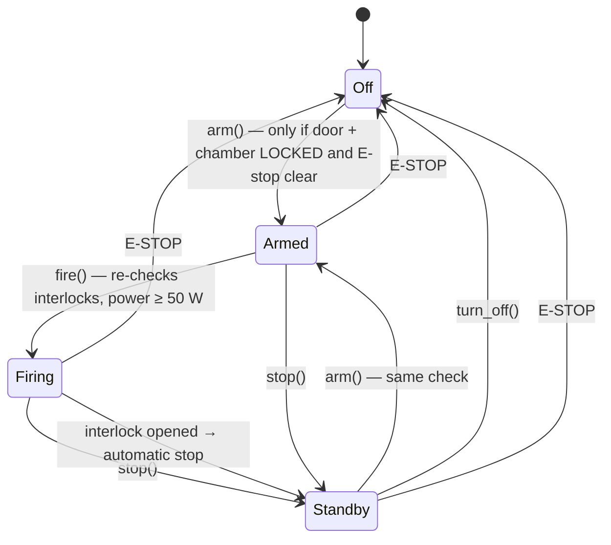
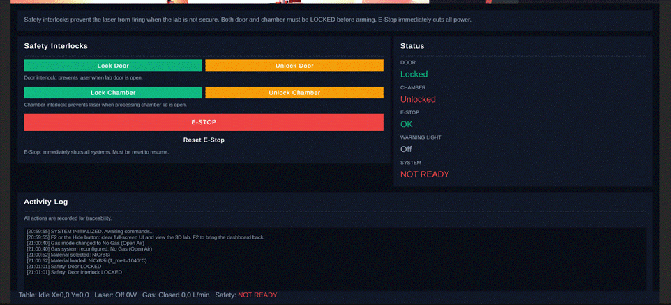
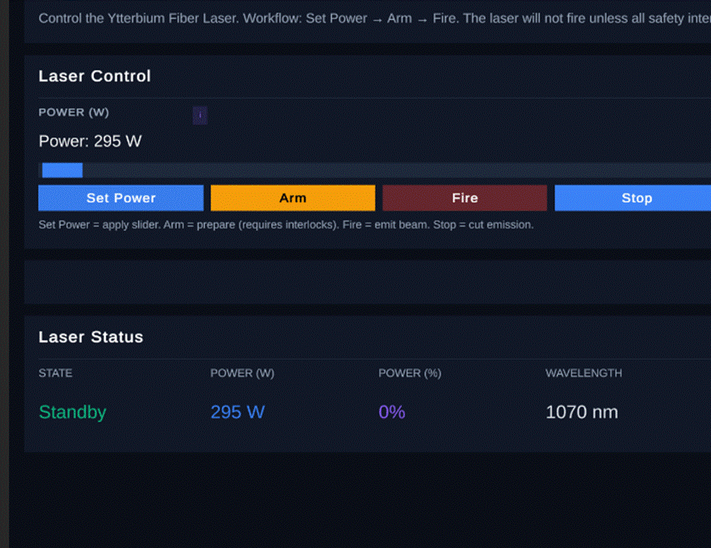
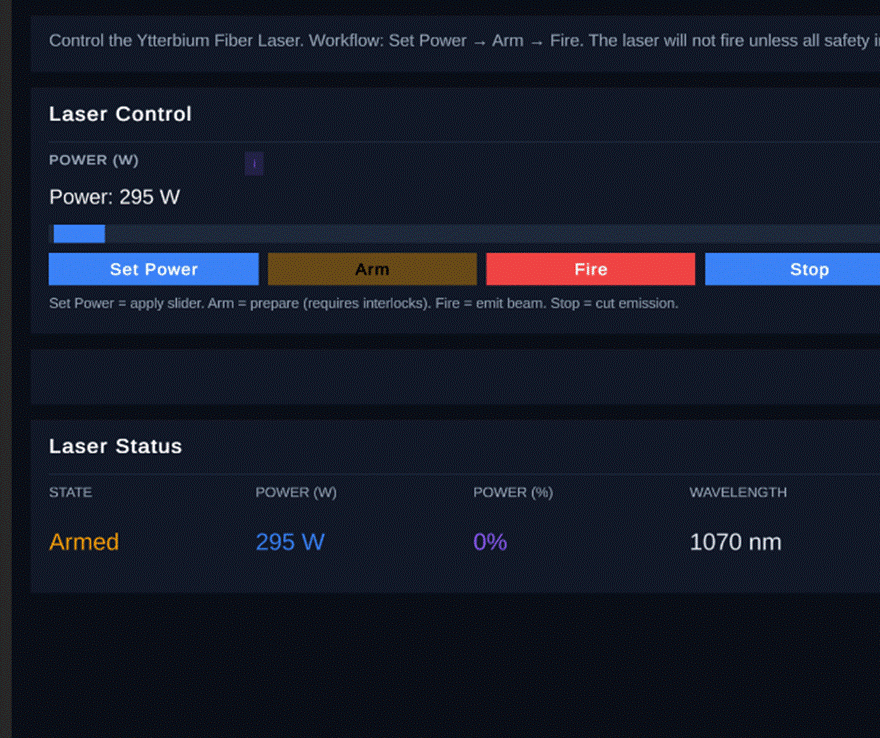
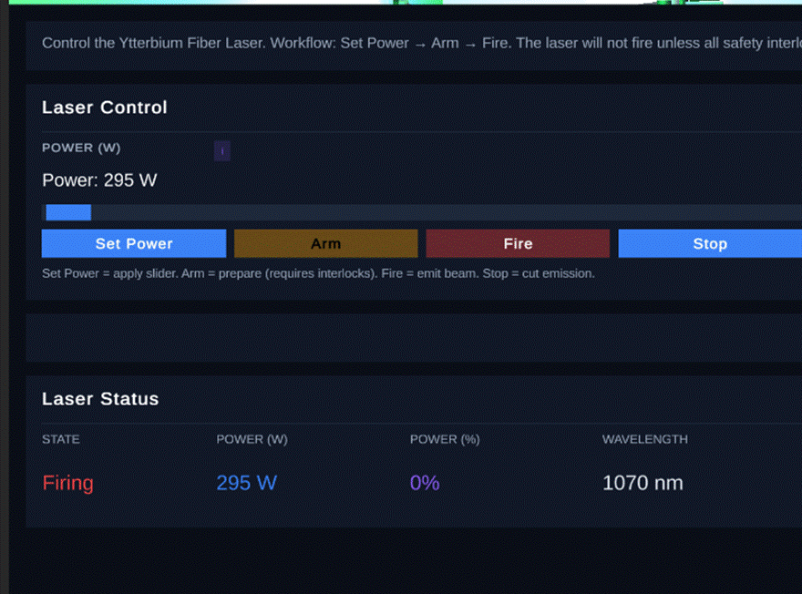
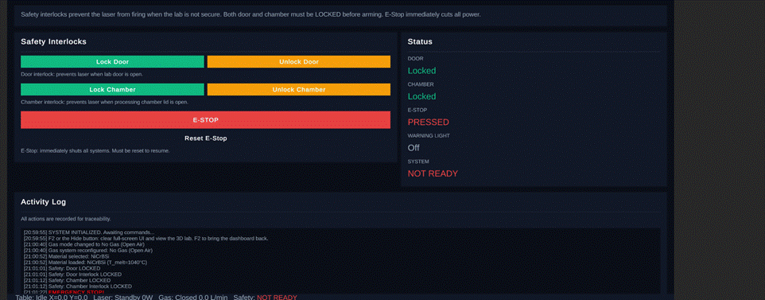

# Safety System

The laboratory houses a **Class 4** fibre laser (300 W CW, 1070 nm — invisible, near-infrared) in a 17.5 m³ corridor-shaped room. Safety was therefore designed as **defence in depth**: a hardware layer specified for the real room, mirrored by a software layer that makes unsafe operation impossible in the control logic — and verified by tests before any hardware is bought.

- [Software layer: state machines](#software-layer-state-machines)
- [The four programmable safety rules](#the-four-programmable-safety-rules)
- [Emergency stop](#emergency-stop)
- [Threat model (STRIDE)](#threat-model-stride)
- [Hardware layer](#hardware-layer)
- [Standards](#standards)

---

## Software layer: state machines

Every device is a finite-state machine owned by a domain entity. The UI can only *request* transitions; entities refuse illegal ones by raising domain exceptions.

**X-Y table** ([`XYTable`](../python/lab_control/domain/entities.py))

**Laser** ([`LaserUnit`](../python/lab_control/domain/entities.py))

**Shielding gas** ([`GasSystem`](../python/lab_control/domain/entities.py)): `Closed → Purging → Flowing`, with flow-rate validation and an O₂ < 100 ppm atmosphere check.

In the dashboard the rule is visible: the **Arm** button is only interactable when `AllInterlocksLocked && state ∉ {Armed, Firing}`, and **Fire** only lights up once armed.

| Not ready | All clear |
|---|---|
|  |  |

| Standby | Armed | Firing |
|---|---|---|
|  |  |  |

Power is one field and readiness is another: all three screenshots are at 295 W; only the FSM state (green / orange / red) changes.

## The four programmable safety rules

| # | Rule | Enforcement | Exception |
|---|---|---|---|
| 1 | **Travel-limit validation** | Every target — and every point of a scan *before the scan starts* — is checked against the table envelope. An out-of-range recipe is rejected up front, never half-way. Scans are capped at 50 000 points. | `TableLimitError` |
| 2 | **Mandatory homing** | The table starts un-homed at power-up and accepts no move until both axes are homed. From `ERROR` (limit trip, E-stop) the only way back to `IDLE` is a fresh `home()`. | `TableNotHomedError`, `TableBusyError` |
| 3 | **Interlock-gated laser** | `arm()` and `fire()` both require door LOCKED ∧ chamber LOCKED ∧ E-stop clear. Opening a door while firing aborts emission within one controller update and writes an `AUTO_STOP_LASER` audit event. | `LaserInterlockError` |
| 4 | **Latching E-stop** | Once pressed it stays pressed until an explicit `reset_e_stop()`; while active every motion or emission request is refused. | `EmergencyStopError` |

All four are exercised by the test suites ([`test_lab_control.py`](../python/lab_control/tests/test_lab_control.py), [`DomainTests.cs`](../UnityHVOF/Assets/Scripts/Tests/EditMode/DomainTests.cs)), so any future change is screened against the same scenarios.

## Emergency stop

`LabControlUseCase.trigger_e_stop()` in a single call:

1. latches `SafetySystem.e_stop_pressed = true`,
2. stops and powers **off** the laser,
3. closes the argon flow,
4. forces the X-Y table into `ERROR` (it must be re-homed),
5. writes `E_STOP_TRIGGERED` to the audit log.

## Threat model (STRIDE)

Only controls that exist in the code are listed.

| Threat | Control in this codebase |
|---|---|
| **Spoofing** of safety state | The laser re-reads interlock state at `arm()` *and* at `fire()`; it never trusts a cached "safe" flag. |
| **Tampering** with set-points | Validated entities and frozen value objects (`Position2D`, `ScanRecipe`, `GCodeLine` …); power, flow and position ranges checked on every write. |
| **Repudiation** | Every operator action and safety event is timestamped in an audit log; simulation runs carry a SHA-256 hash of their result. |
| **Information disclosure** | The simulation audit logger redacts keys such as `api_key`, `password`, `token`; the Materials Project key is read from the environment, never stored in code. |
| **Denial of service** | Solver grids capped at 5 M cells; scans capped at 50 000 points; CFL-derived time step prevents numerical blow-up. |
| **Elevation of privilege** | No code path fires the laser without passing through `LabControlUseCase` and its safety guard. |

## Hardware layer

Specified for the real room (VG building, UPC Vilanova i la Geltrú — 5.00 × 1.27 × 2.76 m):

| Measure | Specification |
|---|---|
| Class 4 enclosure | 3030 aluminium frame + 2 mm galvanised steel panels |
| Door interlocks | Two microswitch interlocks + magnetic reed switch, Hoyles IG432 interlock controller |
| Beam containment at the windowed wall | 3 × Panasonic SF4D-H16 laser safety curtains (EN 12254) |
| Signalling | "Laser On" illuminated sign, LED warning indicator, ISO 7010 W010 / M004 signs on both doors |
| Atmosphere | Argon changeover manifold, purge block, Trolex TX6373 O₂-depletion monitor, fume extractor |
| Fire | 2 × 5 kg CO₂ extinguishers |
| PPE (×3 operators) | Amber eyewear OD ≥ 5 @ 1070 nm (EN 207), EN 388 gloves, 3M Peltor Optime I (SNR 27 dB) |

## Standards

| Standard | Scope |
|---|---|
| IEC 60825-1 | Laser product classification, engineering controls for Class 4 |
| IEC 60825-4 | Laser guards and protective enclosures |
| ISO 11553 | Safety of laser processing machines |
| EN 207 | Laser eye protection |
| EN 12254 | Screens for laser working places |
| ISO 7010 | Safety signs (W010, M004) |
| IEC 60364-1 | Low-voltage electrical installations |
| ISO 15011-4 · ANSI Z136.1 | Fume / airborne contaminant control, safe use of lasers |
| UNE-EN 13150 · 14056 · 14175 | Laboratory workbenches, furniture, fume cupboards |
| Real Decreto 485/1997 · 486/1997 | Spanish workplace signage and minimum workplace safety |
